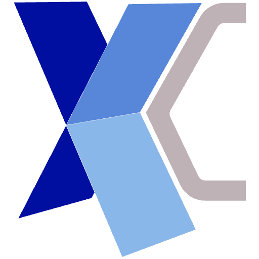

###############
AiiDA-TrainsPot
###############

AiiDA-TrainsPot is an AiiDA workflow that fully automates the training of a machine-learned
interatomic potential. It implements an active learning loop that, starting from a handful of
structures, augments, labels via DFT, trains, explores via classical MD and selects -- based on
committee consensus -- iterating until the committee of potentials no longer disagrees anywhere.

.. raw:: html
   :file: _svg/active_learning.html

**Fully automated.** The loop runs from a small set of starting structures to a trained potential
and its dataset without human intervention.

**One protocol, one dataset.** Every label comes from the same `aiida-quantumespresso`_ protocol, so
pseudopotentials, cutoffs and k-point sampling do not drift across the training set. The level is
yours to choose (``fast``, ``balanced``, ``stringent``); the consistency is not.

**Committee disagreement selects the data.** A configuration is labelled when the committee of
potentials disagrees about it, so the ab initio budget is spent where the model is actually weak
rather than on a fixed schedule.

**Reproducible by construction.** Every structure, calculation and model is a node in the AiiDA_
provenance graph, so a run can be inspected, resumed and repeated.

Get started
===========

.. admonition:: From nothing to a first run
   :class: title-icon-launch-software

   #. :ref:`Install <installation>` AiiDA-TrainsPot on your machine, and the codes it drives
      (Quantum ESPRESSO, LAMMPS, a training engine) on the machine that will run them.
   #. Set up an AiiDA ``Code`` for each of them, and the committee evaluation ``PortableCode``.
   #. Follow the :ref:`worked example <get-started>` and launch your first loop.

.. toctree::
   :hidden:
   :maxdepth: 2

   user_guide/index
   module_guide/index

Citing AiiDA-TrainsPot
======================

If you use AiiDA-TrainsPot in your work, please cite:

    D. Bidoggia, N. Manko, M. Peressi and A. Marrazzo, *AiiDA-TrainsPot: towards automated training
    of neural-network interatomic potentials*, Digital Discovery, 2026, **5**, 2292-2309.
    |AiiDA-TrainsPot paper|_

.. code-block:: bibtex

   @article{bidoggia2026aiidatrainspot,
     title   = {{AiiDA-TrainsPot}: towards automated training of neural-network interatomic potentials},
     author  = {Bidoggia, Davide and Manko, Nataliia and Peressi, Maria and Marrazzo, Antimo},
     journal = {Digital Discovery},
     volume  = {5},
     number  = {5},
     pages   = {2292--2309},
     year    = {2026},
     publisher = {Royal Society of Chemistry},
     doi     = {10.1039/D6DD00005C}
   }

Built with, and supported by
=============================

AiiDA-TrainsPot is built on AiiDA, Quantum ESPRESSO, LAMMPS, MACE, and metatrain:

.. container:: logo-row

    |aiida_logo| |qe_logo| |lammps_logo| |MACE_logo| |metatrain_logo|

.. |aiida_logo| image:: images/AiiDA_transparent_logo.png
    :alt: AiiDA
    :target: https://aiida.net

.. |qe_logo| image:: images/qe_logo.jpg
    :alt: Quantum ESPRESSO
    :target: https://www.quantum-espresso.org

.. |lammps_logo| image:: images/Lammps-logo.png
    :alt: LAMMPS
    :target: https://www.lammps.org

.. |MACE_logo| image:: images/MACE_logo.png
    :alt: MACE
    :target: https://github.com/ACEsuit/mace

This project was supported by:

.. container:: logo-row

    |trieste_logo| |sissa_logo| |max_logo| |icsc_logo|

- |Università degli Studi di Trieste|_.
- |Scuola Internazionale Superiore di Studi Avanzati|_.
- |Centro Nazionale di Ricerca HPC, Big Data e Quantum Computing|_.
- |EU Centre of Excellence "MaX – Materials Design at the Exascale"|_.
- POC Programma Operativo Complementare al POR FSE Friuli Venezia Giulia 2014-2020.

Contributions are welcome: see CONTRIBUTING.md_ and the CLA.md_.

.. _AiiDA: http://aiida.net
.. _aiida-quantumespresso: https://aiida-quantumespresso.readthedocs.io/
.. _CLA.md: https://github.com/aiida-trieste-developers/aiida-trains-pot/blob/main/CLA.md
.. _CONTRIBUTING.md: https://github.com/aiida-trieste-developers/aiida-trains-pot/blob/main/CONTRIBUTING.md

.. |AiiDA-TrainsPot paper| replace:: DOI: 10.1039/D6DD00005C
.. _AiiDA-TrainsPot paper: https://doi.org/10.1039/d6dd00005c

.. |Università degli Studi di Trieste| replace:: Università degli Studi di Trieste
.. _Università degli Studi di Trieste: https://portale.units.it/en
.. |Scuola Internazionale Superiore di Studi Avanzati| replace:: Scuola Internazionale Superiore di Studi Avanzati
.. _Scuola Internazionale Superiore di Studi Avanzati: https://www.sissa.it/it
.. |Centro Nazionale di Ricerca HPC, Big Data e Quantum Computing| replace:: Centro Nazionale di Ricerca HPC, Big Data e Quantum Computing
.. _Centro Nazionale di Ricerca HPC, Big Data e Quantum Computing: https://www.supercomputing-icsc.it/en/icsc-home/
.. |EU Centre of Excellence "MaX – Materials Design at the Exascale"| replace:: EU Centre of Excellence "MaX – Materials Design at the Exascale"
.. _EU Centre of Excellence "MaX – Materials Design at the Exascale": https://www.max-centre.eu/
